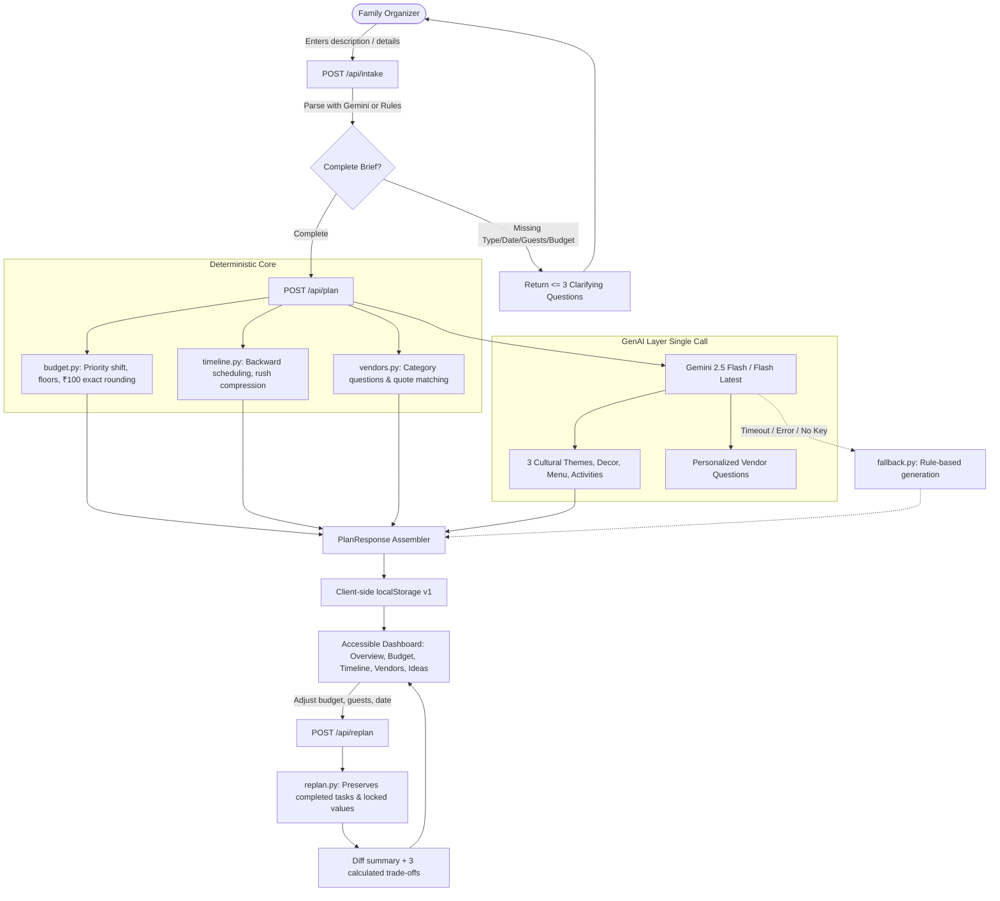

# Jashn — System Architecture & Design Philosophy

## 1. Core Paradigm: "AI Proposes, Code Disposes"
In high-stakes family event planning (e.g. Indian weddings, milestone birthdays, and community festivals), financial numbers and deadlines must be **100% deterministic**.
A generative AI model can hallucinate numbers, fail arithmetic sums, invent non-existent local businesses, or fabricate misleading price guarantees.

**In Jashn:**
- **Deterministic Code Engines dictate all numbers**:
  - `app/services/budget.py`: Computes category allocations using the largest-remainder method rounded to ₹100, ensuring `sum(allocations) == total_budget` down to the exact rupee. Enforces category floors and a 5–10% contingency reserve.
  - `app/services/timeline.py`: Calculates backward schedule dates from the target event date, enforces proportional compression ("Rush") when lead times are tight, and flags overdue and blocked dependencies.
  - `app/services/replan.py`: Recalculates budgets and timelines when parameters change while preserving completed tasks and user-locked estimates. Computes 2–3 concrete trade-off options with mathematically validated savings.
  - `app/services/vendors.py`: Maps category budget estimates and pairs them with critical questions to ask vendors. **Never invents vendor names, phone numbers, or confirmed prices.**
- **GenAI Layer (Gemini) enriches the experience**:
  - Infuses cultural context (Awadhi, Rajasthani, South Indian, Maharashtrian, Bengali, etc.).
  - Generates 3 cohesive theme concepts (Budget-Friendly, Balanced, Grand) with specific decor concepts, dietary-compliant menu highlights, and engaging guest activities.
  - Personalizes targeted negotiation questions for vendors.
  - Explains trade-off options with empathy for the Family Organizer.

---

## 2. System Flow Diagram

---

## 3. Stateless Backend & Persistent Client Store
- The FastAPI server carries **zero session state** and requires no database.
- The client persists the complete plan in `localStorage` under `jashn_plan_v1`, validated on every load against the versioned Pydantic schema.
- Users can export plans as portable JSON files, import previously saved plans, or start fresh.
- All amounts in the UI are formatted in INR with standard Indian digit grouping (`en-IN`, e.g. ₹8,00,000) and explicitly labeled as estimates.
